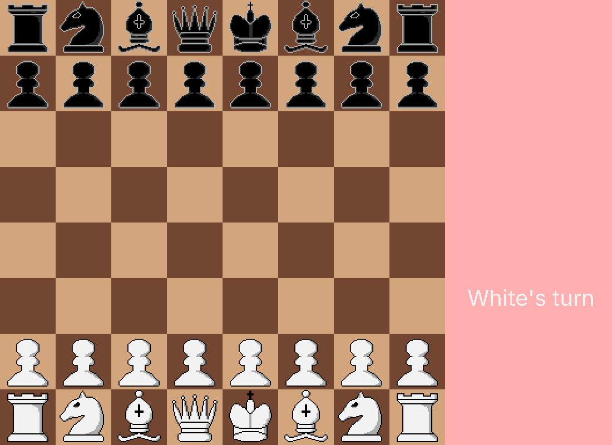

# OOP Chess Game (Java)

A two-player chess game in Java with a Swing GUI, built to practise object-oriented design: inheritance, encapsulation and polymorphism.

University project · University of Messina · Author: **Sepehr Mojdehdehbaher**



## Features

- Full board with all six piece types; each piece class defines its own moves
- Turn handling (white / black) shown in the side panel
- Castling and pawn promotion (choose the new piece)
- Check, checkmate and stalemate detection
- Moves that would leave your own king in check are not allowed

## Design

- `Piece` is an abstract base class; `King`, `Queen`, `Rook`, `Bishop`, `Knight` and `Pawn` override `canMove(...)`
- `GamePanel` runs the game loop and draws the board; `Board` draws the squares; `Mouse` handles input
- `GameState` holds the game states and the check test
- `PolymorphismDemo` prints a short demo of dynamic binding (the same `canMove` call behaving differently for each piece) before the game starts

The class diagram is in [`UML-Diagram/chess-uml.png`](UML-Diagram/chess-uml.png).

## Run it

Requires **Java 17+**. From the repository root:

```bash
git clone https://github.com/Sepi-X/oop-chess-game.git
cd oop-chess-game
javac main/*.java piece/*.java
java main.main
```

Run from the repository root so the piece images in `piece/` are found.

## Structure

```
main/         game loop, board, mouse input, game state, polymorphism demo
piece/        Piece base class, the six piece classes and their images
UML-Diagram/  class diagram
docs/         screenshot
```
